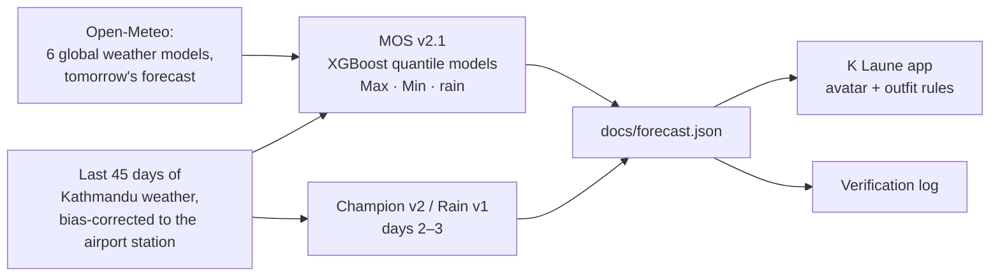

# के लाउने? (K Laune): what to wear in Kathmandu

**Kathmandu's weather forecast, translated into what to wear.** A machine-learning forecast for Kathmandu Airport, corrected for the valley's local climate, drives a small web app that dresses a personal avatar for tomorrow: morning and afternoon outfits, alternatives, and whether to take an umbrella (or a raincoat, if you ride a scooter). English and Nepali.

**Live app: https://binamraaa.github.io/Kathmandu_Climate_Insights/**

[](https://github.com/Binamraaa/Kathmandu_Climate_Insights/actions/workflows/forecast.yml)


---

## Contents

1. [What the app does](#what-the-app-does)
2. [How it works](#how-it-works)
3. [Results](#results)
4. [Real-world verification](#real-world-verification)
5. [Running it yourself](#running-it-yourself)
6. [Data and credits](#data-and-credits)
7. [Limitations](#limitations)
8. [Project history](#project-history)
9. [Roadmap](#roadmap)

---

## What the app does

- **Your avatar, your clothes.** A seven-question builder (age group, man / woman / rather not say, skin tone, hair, usual style, walk or scooter, how much the cold bothers you) creates an avatar. Styles cover modern and traditional Kathmandu dress: streetwear, smart casual, dresses, kurta-suruwal and kurta-pyjama, daura-suruwal with dhaka topi, and sari.
- **Morning and afternoon looks.** Kathmandu's day-night swing is large, so the app shows what to wear at about 8 am and at the afternoon high, e.g. *sweater in the morning, T-shirt by afternoon*.
- **Options, not orders.** An "Other ideas" row offers three alternatives for the same weather, mostly from your own style plus one crossover. The catalogue includes leather and denim jackets, flannel and linen shirts, kurti with jeans, pashmina, haku patasi, bakhu and gunyu-cholo.
- **Honest uncertainty.** Tomorrow's high comes with a 10–90% range. When the range straddles a clothing boundary, the advice says "bring a layer" instead of guessing; this is tuned to appear on about a quarter of days.
- **Scooter mode.** Riders get wind-chill-adjusted advice (about 4 °C colder in the morning), a raincoat instead of an umbrella, and gloves on cold mornings.
- **Two languages.** English, or Nepali with key words in Devanagari and familiar garment names kept as people say them (बिहान hoodie, दिउँसो T-shirt।).
- **Light.** One HTML file, no framework, no tracking. Your avatar is stored only in your browser.

## How it works



1. **Every evening at 18:15 Nepal time** a GitHub Action runs `src/export_forecast.py`.
2. **Tomorrow** comes from **MOS v2.1** (Model Output Statistics): XGBoost models that take forecasts from six global weather models (ECMWF IFS, DWD ICON, NOAA GFS, JMA, CMA and Open-Meteo best match) together with recent station history, and learn how to correct them for Kathmandu. Global models see the valley as a blur of floor and surrounding hills and run 2–3 °C too cold on raw output; MOS learns that correction from the airport record.
3. **Days 2 and 3** come from the station-only models (Champion v2 for temperature, Rain v1 for rain).
4. The forecast is committed to `docs/forecast.json`, which GitHub Pages serves to the app, and appended to the verification log.
5. The app turns temperatures into outfits with simple, readable rules (six warmth tiers × each clothing style), adjusted for the user's cold sensitivity and travel mode.

## Results

All scores are out-of-sample. MAE = mean absolute error in °C (lower is better). Brier = error of rain probabilities (lower is better).

### Tomorrow's forecast, honest day-ahead test (Jan 2024 – Aug 2025, 583 days, blocked cross-validation)

| Model | Max MAE | Min MAE | Rain Brier | Clothing band right* |
| --- | --- | --- | --- | --- |
| **MOS v2.1 (live)** | 1.09 | **0.81** | **0.117** | 87% |
| MOS v2 (8 weather models, 145 features) | **1.06** | 0.85 | 0.129 | 88% |
| Champion v2 / Rain v1 (station only) | 1.21 | 0.83 | 0.129 | 78% |
| Best single weather model, bias-corrected | 1.41 | 0.95 | – | 66% |
| Persistence (tomorrow = today) | 1.33 | 0.86 | – | 75% |

\* Right 5 °C clothing band for the afternoon high, with "bring a layer" advice counted as covering both neighbouring bands.

- The 10–90% range contains the actual high **78%** of the time and the actual low **80%** of the time (target 80%).
- The umbrella flag catches **85%** of wet days and is right **70%** of the time it says yes.
- MOS gains most in **winter** (0.80 vs 1.03 °C) and the **pre-monsoon and monsoon** seasons, when incoming weather systems matter and station history alone can't see them coming.

### Station-only models (test period Aug 2019 – 2024)

| Model | Max MAE t+1 | Min MAE t+1 |
| --- | --- | --- |
| Phase 1 champion (2025) | 1.34 | 0.94 |
| Persistence | 1.39 | 0.91 |
| **Champion v2** | **1.24** | **0.85** |

### Lessons worth keeping

- **Baselines first.** The original champion barely beat "tomorrow = today" and lost to it on minimum temperature. Champion v2 fixed that by feeding today's readings in directly, predicting anomalies from a training-only climatology, and dropping the `Year` feature that trees can't extrapolate.
- **Beware flattering archives.** MOS v1, trained on Open-Meteo's historical-forecast archive (stitched from the first hours of each model run), scored 0.87 °C. Retrained on genuine 24-hour-ahead forecasts, the honest figure is about 1.1 °C. Most of the "improvement" was look-ahead.
- **Fewer, better inputs.** With under 600 days of training data, pruning from 145 to 53 features and dropping two short-history weather models improved minimum temperature and rain.
- **Uncertainty needs calibration.** Raw quantile ranges covered only 37–62% of outcomes; conformal widening brings them to the stated 80%.

## Real-world verification

Lab scores are not the same as real days, so every live forecast is logged in [`data/verification/forecast_log.csv`](data/verification/forecast_log.csv), next to a raw Open-Meteo forecast as a "typical weather app" reference. Observed weather from the MFD/DHM daily bulletin is added to `data/verification/observations.csv`, and

```
python -m src.verify report
```

prints a scorecard for days 1–3: error and warm/cold bias, clothing-band accuracy, range hit rate, and rain caught vs false alarms, side by side with the reference. Logging started on 12 October 2026; results will be added here once about 30 days are verified.

## Running it yourself

See **[SETUP.md](SETUP.md)** for the full guide (Windows + Anaconda). In short:

```
conda create -n ktm-climate python=3.12 -y
conda activate ktm-climate
pip install -r requirements.txt
python -m src.predict --replay 2023-07-15     # offline check
python -m src.export_forecast                 # live forecast → docs/forecast.json
python -m http.server 8000 -d docs            # app at http://localhost:8000
```

Repository layout:

```
src/          forecasting, training, live input, export and verification code
models/       trained models as XGBoost JSON (MOS v2.1, MOS v2, Champion v2, Rain v1)
notebooks/    station-only model development (Champion v2, Rain v1) and the original 2025 work
docs/         the app (index.html) and tonight's forecast.json, served by GitHub Pages
data/         station record and the verification log
.github/      the daily forecast workflow
assets/       README images
```

## Data and credits

- **Station record:** Department of Hydrology and Meteorology (DHM), Nepal, Kathmandu Airport, daily, 1999 – Oct 2024.
- **Recent station data:** NOAA Global Summary of the Day (GSOD), station 444540 (VNKT), bias-adjusted to the DHM record (MAE about 0.5 °C over 25 years of overlap).
- **Weather-model forecasts and live data:** [Open-Meteo.com](https://open-meteo.com/), licensed under CC BY 4.0, serving forecasts from ECMWF, DWD (ICON), NOAA (GFS), JMA and CMA.
- **Fonts:** Bricolage Grotesque, Atkinson Hyperlegible and Mukta (Google Fonts).

Avatars and clothing illustrations are original, drawn in code. Skin tone, hair and clothing are chosen by the user; the app never infers ethnicity or religion.

## Limitations

- **One station.** Forecasts are for Kathmandu Airport. Higher parts of the valley (Thankot, Godawari, Budhanilkantha) can be 2–3 °C cooler; the city centre can be warmer.
- **Winter mornings are hardest.** Cold-air pooling on the valley floor is where every model, ours included, struggles most.
- **Data lag.** NOAA's GSOD file currently lags by months, which limits how recent the training data can be.
- **Not an official forecast.** For warnings and severe weather, follow the Meteorological Forecasting Division (DHM).

## Project history

This repository began in 2025 as a temperature-forecasting study on 25 years of DHM data:

1. **Champion forecaster:** XGBoost vs Random Forest with time-series cross-validation; XGBoost won (t+1 Max MAE 1.34 °C).
2. **The data gap:** richer atmospheric variables (humidity, wind, solar radiation) existed only from late 2020, ruling out a simple merge.
3. **Failed improvements:** adding 25 years of humidity made the model worse (non-stationarity); a physics-informed model on 2020–2024 data overfit.
4. **Confidence model:** a classifier to flag days likely to have high forecast error.

The 2026 rebuild re-benchmarked everything against persistence, replaced the confidence classifier with calibrated forecast ranges, added global weather models through MOS, and turned the forecasts into the K Laune app. The original notebooks remain in `notebooks/`.

## Roadmap

- **Rolling bias correction** from the verification log once 30+ days are verified.
- **Comfort feedback** ("too cold / just right / too warm") to tune each user's cold sensitivity over time.
- **Neighbourhood elevation adjustment** using the standard lapse rate (about 0.6 °C cooler per 100 m).
- **More stations** across the valley, if DHM data can be obtained.
- **Retraining every few months** as new station data arrives.

---

Built by **Binamra Bhusal**, environmental engineer, Kathmandu.
