# के लाउने? (K Laune): what to wear in Kathmandu

**Kathmandu's weather forecast, translated into what to wear.** This repository holds a two-year journey: a temperature-forecasting study on 25 years of Kathmandu station data (2025), rebuilt in 2026 into a live forecasting system that corrects global weather models for the Kathmandu Valley and powers a small bilingual web app. The app dresses a personal avatar for tomorrow: morning and afternoon outfits, alternatives, and whether to take an umbrella (or a raincoat, if you ride a scooter).

**Live app: https://binamraaa.github.io/Kathmandu_Climate_Insights/**

[](https://github.com/Binamraaa/Kathmandu_Climate_Insights/actions/workflows/forecast.yml)

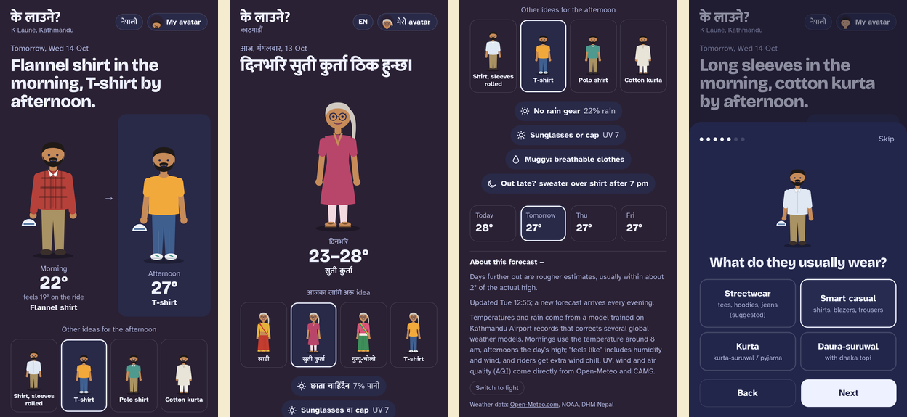

<sub>Left to right: a scooter rider's day in English (flannel shirt in the morning, T-shirt by afternoon, with alternatives); the Nepali view for an elder on a warm day; advice chips for UV, mugginess and the evening, with the day tabs; the avatar builder.</sub>

## At a glance

| | |
| --- | --- |
| **Forecast target** | Daily max/min temperature and rain at Kathmandu Airport (DHM station), 1–3 days ahead |
| **Data** | DHM daily record 1999–2024, NOAA GSOD to 2025, day-ahead forecasts from 6 global weather models |
| **Live model** | MOS v2.1: XGBoost quantile models correcting global weather models with station history |
| **Accuracy (tomorrow)** | Max 1.09 °C, Min 0.81 °C mean error; 80% forecast ranges that hold; rain flag catches 85% of wet days |
| **App** | One HTML file on GitHub Pages; avatar builder, outfit ideas, English / Nepali, scooter mode |
| **Automation** | GitHub Action forecasts twice a day (05:25 for today, 17:32 for tomorrow, Nepal time) and logs each forecast for verification |

---

## Contents

**Part I: K Laune today**
1. [What the app does](#1-what-the-app-does)
2. [How it works](#2-how-it-works)
3. [Results](#3-results)
4. [Real-world verification](#4-real-world-verification)

**Part II: The research journey**

5. [The problem and the data](#5-the-problem-and-the-data)
6. [2025, Phases 1–4: champion forecaster and confidence model](#6-2025-phases-14-champion-forecaster-and-confidence-model)
7. [2026, Phases 5–9: audit, rebuild and the app](#7-2026-phases-59-audit-rebuild-and-the-app)
8. [Lessons worth keeping](#8-lessons-worth-keeping)

**Part III: Using the repository**

9. [Running it yourself](#9-running-it-yourself)
10. [Repository guide](#10-repository-guide)
11. [Data, credits and acknowledgements](#11-data-credits-and-acknowledgements)
12. [Limitations](#12-limitations)
13. [Roadmap](#13-roadmap)

---

# Part I: K Laune today

## 1. What the app does

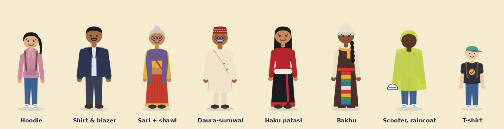

- **Your avatar, your clothes.** A seven-step builder (age group, man / woman / rather not say, skin tone, hair and spectacles, usual style, walk or scooter, how much the cold bothers you) creates an avatar. Styles cover modern and traditional Kathmandu dress: streetwear, smart casual, dresses, kurta-suruwal and kurta-pyjama, daura-suruwal with dhaka topi, and sari.
- **Morning and afternoon looks.** Kathmandu's day-night swing is large, so the app shows what to wear at about 8 am and at the afternoon high, e.g. *sweater in the morning, T-shirt by afternoon*.
- **Options, not orders.** An "Other ideas" row offers three alternatives for the same weather, mostly from your own style plus one crossover. The catalogue includes leather and denim jackets, flannel and linen shirts, kurti with jeans, pashmina, haku patasi, bakhu and gunyu-cholo.
- **Honest uncertainty.** Tomorrow's high comes with a 10–90% range. When the range straddles a clothing boundary, the advice says "bring a layer" instead of guessing, tuned to appear on about a quarter of days.
- **Protection decided on the day.** Nobody knows tomorrow's UV or air quality when setting up an avatar, so the builder only asks about spectacles. When a day calls for a cap, sunglasses or a mask (strong sun, polluted air), the avatar wears them and a small "Show on my avatar" row appears right there, with separate switches for the morning and the afternoon, so people choose while looking at that day's conditions. Choices are remembered; the advice chips stay either way.
- **More than temperature.** The advice also weighs UV (cap, sunglasses, sunscreen, or a chata for shade), wind, humidity ("feels like" and muggy days), air quality (a mask chip when AQI is high, common in Kathmandu's dry season), and an "out late?" note when the evening calls for something warmer. The morning and evening temperatures follow the weather models' hour-by-hour curve, scaled to our corrected low and high.
- **Scooter mode.** Riders get wind-chill-adjusted advice (about 4 °C colder in the morning), a raincoat instead of an umbrella, and gloves on cold mornings.
- **Two languages.** English, or Nepali with key words in Devanagari and familiar garment names kept as people say them (बिहान hoodie, दिउँसो T-shirt।).
- **Light and private.** One HTML file, no framework, no tracking. Your avatar is stored only in your own browser.

## 2. How it works

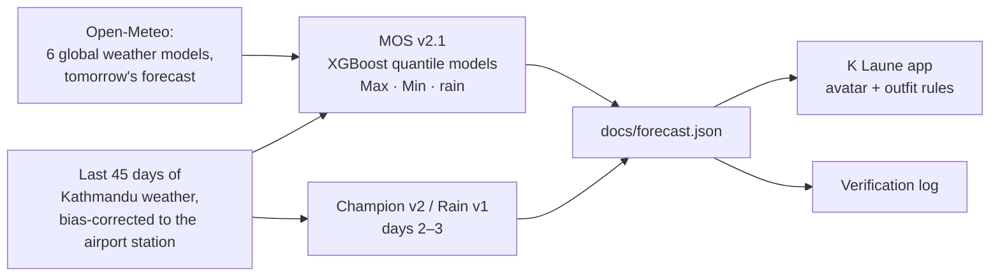

1. **Twice a day** a GitHub Action runs `src/export_forecast.py`: at about **05:25 Nepal time** it forecasts **today** (using yesterday's complete data), and at about **17:32** it forecasts **tomorrow**. The mode follows the Nepal clock, so a delayed run still does the right thing, and today's forecast stays in the app all day. The app opens on today during the day and on tomorrow from 5 pm.
2. **The next forecast day** (today in the morning run, tomorrow in the evening run) comes from **MOS v2.1** (Model Output Statistics): XGBoost models that take day-ahead forecasts from six global weather models (ECMWF IFS, DWD ICON, NOAA GFS, JMA, CMA and Open-Meteo best match) together with recent station history, and learn how to correct them for Kathmandu. Global models see the valley as a blur of valley floor and surrounding hills and run 2–3 °C too cold on raw output; MOS learns that correction from the airport record.
3. **The following two days** come from the station-only models (Champion v2 for temperature, Rain v1 for rain).
4. The forecast is committed to `docs/forecast.json`, served to the app by GitHub Pages, and appended to the verification log.
5. The app turns temperatures into outfits with simple, readable rules (six warmth tiers for each clothing style), adjusted for the user's cold sensitivity and travel mode.

## 3. Results

All scores are out-of-sample. MAE = mean absolute error in °C (lower is better). Brier = error of rain probabilities (lower is better).

**Tomorrow's forecast, honest day-ahead test** (Jan 2024 – Aug 2025, 583 days, 5-fold blocked cross-validation)

| Model | Max MAE | Min MAE | Rain Brier | Clothing band right* |
| --- | --- | --- | --- | --- |
| **MOS v2.1 (live)** | 1.09 | **0.81** | **0.117** | 87% |
| MOS v2 (8 weather models, 145 features) | **1.06** | 0.85 | 0.129 | 88% |
| Champion v2 / Rain v1 (station only) | 1.21 | 0.83 | 0.129 | 78% |
| Best single weather model, bias-corrected | 1.41 | 0.95 | – | 66% |
| Persistence (tomorrow = today) | 1.33 | 0.86 | – | 75% |

\* Right 5 °C clothing band for the afternoon high, with "bring a layer" advice counted as covering both neighbouring bands.

- The 10–90% range contains the actual high **78%** and the actual low **80%** of the time (target 80%).
- The umbrella flag catches **85%** of wet days and is right **70%** of the time it says yes, flagging 40% of days.
- MOS v2.1 gains most in **winter** (0.80 vs 1.03 °C) and the **pre-monsoon and monsoon** seasons, when incoming weather systems matter and station history alone can't see them coming.

## 4. Real-world verification

Lab scores aren't the same as real days, so every live forecast is logged in [`data/verification/forecast_log.csv`](data/verification/forecast_log.csv), next to a raw Open-Meteo forecast as a "typical weather app" reference. Observed weather from the MFD/DHM daily bulletin is added to `data/verification/observations.csv`, and `python -m src.verify report` prints a scorecard for days 1–3: error and warm/cold bias, clothing-band accuracy, range hit rate, and rain caught vs false alarms, side by side with the reference.

The first live forecast (issued 12 October 2026) already shows the difference: for 13 October, K Laune said **28 °C, dry (5% rain)**; the raw weather-model reference said **24.5 °C, 69% rain**. Results will be published here once about 30 days are verified.

---

# Part II: The research journey

## 5. The problem and the data

The goal was a reliable 1–3 day forecast of daily maximum and minimum temperature for Kathmandu. An early test of a 5-day horizon showed accuracy falling off sharply beyond 72 hours, so the scope was fixed at **1–3 days**.

The core dataset is the **DHM daily record for Kathmandu Airport, 1999–2024** (9,422 days, no gaps): maximum and minimum temperature and precipitation. Kathmandu's climate is dominated by a warm, wet monsoon (June–September) and a dry, cold winter with large day-night swings.

| 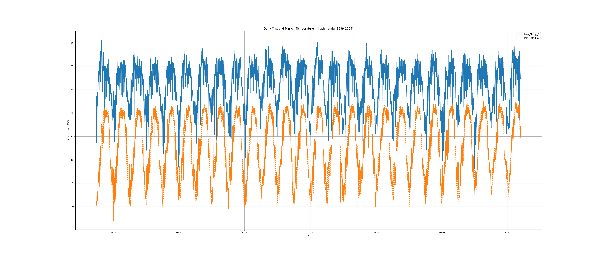 | 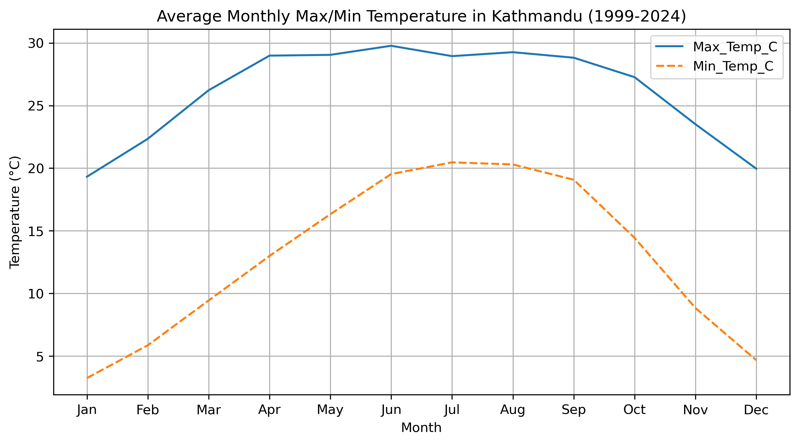 |
| :---: | :---: |
| *Daily maximum and minimum temperature, 1999–2024* | *Average monthly temperature* |

| 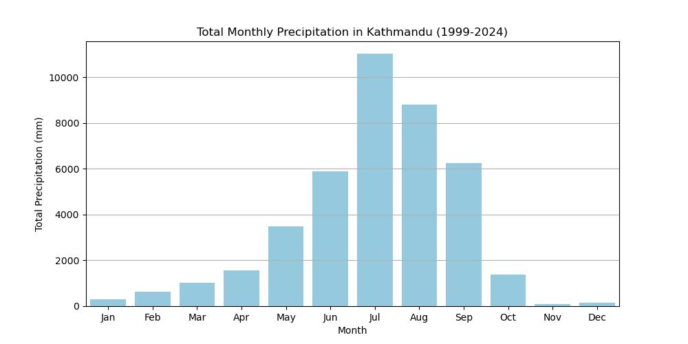 | 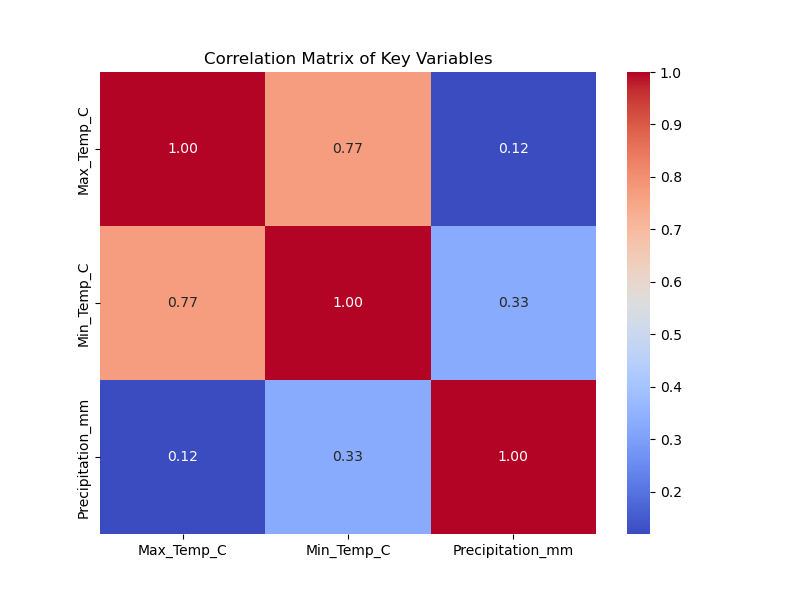 |
| :---: | :---: |
| *Monthly precipitation: the monsoon dominates* | *Feature correlations* |

## 6. 2025, Phases 1–4: champion forecaster and confidence model

### Phase 1: establishing a champion forecaster

Lag, rolling-window and seasonal features were engineered from the 25-year record. XGBoost and Random Forest were tuned with `RandomizedSearchCV` and `TimeSeriesSplit`. XGBoost won and became the **Phase 1 champion** (t+1 Max MAE 1.34 °C, Min 0.94 °C).

| 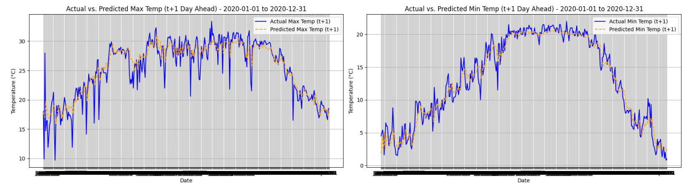 | 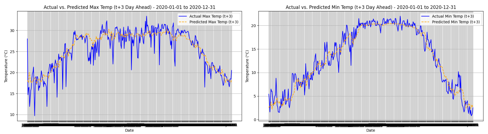 |
| :---: | :---: |
| *Day 1: actual vs predicted* | *Day 3: actual vs predicted* |

### Phase 2: the data gap

Richer atmospheric variables (relative humidity, wind speed and direction, solar radiation) were obtained, but only from **late 2020 onward**, while the core record started in 1999. This gap shaped every later experiment.

### Phase 3: improvements that failed, and why

| Model | Max MAE | Min MAE | What happened |
| :--- | :---: | :---: | :--- |
| Linear regression | 1.35 | 0.96 | Baseline |
| Tuned Random Forest | 1.40 | 0.96 | Beaten by XGBoost |
| XGBoost with 25 years of humidity (`df_historical`) | 1.64 | 1.39 | Worse: relationships between variables changed over 25 years (non-stationarity) |
| Physics-informed model on 2020–24 data (`df_recent`) | 1.54 | 0.92 | Overfit: rich features, too few years |
| **XGBoost Phase 1 champion** | **1.34** | **0.94** | Best of the 2025 models |

### Phase 4: a confidence model

If the newer data couldn't improve accuracy, perhaps it could predict *reliability*. A classifier was built to flag days when the champion was likely to miss badly, using dew point, intra-day solar dynamics and anomaly features. It flagged a cautious subset of high-error days (around 20% recall at about 43% precision, against a base rate of roughly 25–29%).

| 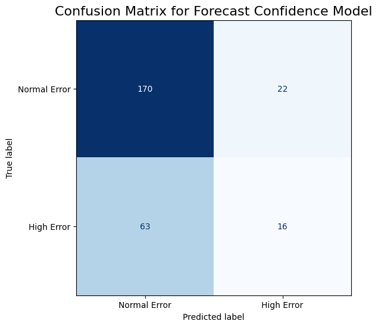 | 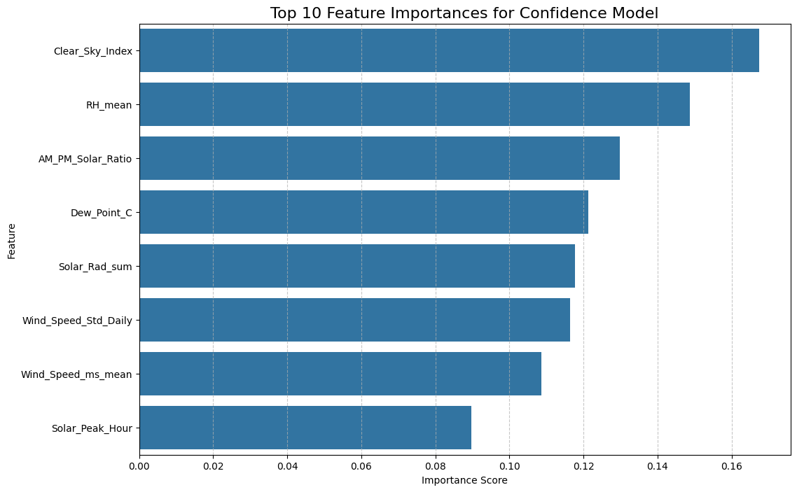 |
| :---: | :---: |
| *Confusion matrix, confidence model* | *Top features driving forecast unpredictability* |

The 2025 plan ended with a deployment blueprint (a Flask/FastAPI endpoint returning forecasts with a HIGH/LOW confidence label) and LSTMs as future work.

## 7. 2026, Phases 5–9: audit, rebuild and the app

### Phase 5: audit against simple baselines

Before building further, the champion was re-benchmarked against **persistence** (tomorrow = today) on the same test period. Persistence scored 1.39 °C on Max and **0.91 °C on Min**, so the champion barely beat it on Max and lost on Min, and plain linear regression did nearly as well as XGBoost. Three causes:

1. The model never saw **today's** readings directly (its most recent lag was yesterday).
2. It predicted raw temperature rather than the **anomaly** from the seasonal normal.
3. A `Year` feature that tree models can't extrapolate beyond the training years.

The audit also found that the confidence model's accuracy (0.69) was below simply calling every day "normal" (0.71), that its plots came from a stale model object, and that its error threshold leaked test data.

### Phase 6: Champion v2 and Rain v1

**Champion v2** fixed all three causes: today's readings as features, anomaly targets from a training-only climatology, no `Year`, and one tuned model per horizon and variable. On the same 2019–2024 test it reached **1.24 °C (Max) and 0.85 °C (Min)**, 11% and 7% better than persistence, which had been the real bar all along. A deeper check confirmed the ceiling: a regularised linear model on the same features scored 1.26, so station history alone had little more to give.

| Station-only models, test Aug 2019 – 2024 | Max MAE t+1 | Min MAE t+1 |
| :--- | :---: | :---: |
| Phase 1 champion | 1.34 | 0.94 |
| Persistence | 1.39 | 0.91 |
| **Champion v2** | **1.24** | **0.85** |

**Rain v1**, a wet-day classifier, showed 15% skill over climatology for tomorrow (AUC 0.91) but almost none beyond, which is why the app treats days 2–3 rain as seasonal odds. The binary confidence model was retired in favour of **calibrated forecast ranges** (quantile regression), which say more and can be checked.

### Phase 7: new data and the weather-model benchmark

- **NOAA GSOD** daily data for the same airport station (444540, VNKT) agreed with DHM to 0.50 °C (Max) and 0.49 °C (Min) over 25 years, so it was bias-adjusted by month and used to extend the record to August 2025.
- **Global weather models** (via Open-Meteo) were benchmarked against the station. Raw, they were 2–3 °C off on Max, too cold for the valley floor. Bias-corrected, they beat the station model on Max but not on Min or rain.

### Phase 8: MOS, and an honest correction

**MOS v1** combined weather-model forecasts with station history and scored 0.87 °C on Max. But its inputs came from Open-Meteo's historical-forecast archive, which stitches together the first hours of each model run: almost no look-ahead. **MOS v2** was retrained on genuine 24-hour-ahead forecasts (Previous Runs API) with blocked cross-validation; the honest Max error is about 1.1 °C. **MOS v2.1** pruned the inputs from 145 to 53 features and dropped two weather models with short histories, improving Min (0.81) and rain (Brier 0.117). It is the live model. Its quantile ranges were calibrated with conformal widening, since raw ranges covered only 37–62% of outcomes instead of 80%.

### Phase 9: from forecast to app

The 2025 API blueprint became something simpler and cheaper: a static app on GitHub Pages fed by a nightly GitHub Action, with no server and no cost. Design went through several rounds with one rule throughout: tell people what to wear, not just the temperature. The app moved from text to avatars, then to personalised avatars covering age, gender and Kathmandu's mix of modern and traditional dress, then to outfit options rather than a single prescription, and finally to a Nepali mode with Devanagari. A verification log now records every live forecast against what actually happened.

## 8. Lessons worth keeping

- **Baselines first.** A model that doesn't beat "tomorrow = today" isn't a forecast yet. Persistence was the real bar for the 2025 champion.
- **"Failed" experiments are findings.** Non-stationarity (Phase 3) and overfitting on short records explain why more data didn't help in 2025.
- **Beware flattering data.** The jump from 0.87 to about 1.1 °C between MOS v1 and v2 was entirely look-ahead in the training archive.
- **Fewer, better inputs.** With under 600 days of training data, pruning features improved results.
- **Uncertainty needs calibrating.** Uncalibrated ranges looked precise and were wrong half the time.
- **Accuracy isn't usefulness.** Clothing advice is right on 76–78% of days with hard 5 °C cutoffs whatever the model; soft boundaries ("bring a layer") lift it to about 87%.

---

# Part III: Using the repository

## 9. Running it yourself

See **[SETUP.md](SETUP.md)** for the full guide (Windows + Anaconda). In short:

```
conda create -n ktm-climate python=3.12 -y
conda activate ktm-climate
pip install -r requirements.txt
python -m src.predict --replay 2023-07-15     # offline check against recorded data
python -m src.export_forecast                 # live forecast → docs/forecast.json
python -m http.server 8000 -d docs            # app at http://localhost:8000
```

## 10. Repository guide

```
src/          forecasting, training, live input, export and verification code
models/       trained models as XGBoost JSON: mos_v2_1 (live), mos_v2, champion_v2, rain_v1
notebooks/    model development, 2025 and 2026
docs/         the app (index.html) and tonight's forecast.json, served by GitHub Pages
data/         DHM station record and the verification log
images/       figures from the 2025 study
assets/       README images
.github/      the daily forecast workflow
```

**Notebooks**

| Notebook | Phase | What it covers |
| --- | --- | --- |
| `Ktm_Tempr_Data_cleanup_.ipynb` | Data | Cleaning the DHM record |
| `EDA_KTM_HISTORIC.ipynb` | Data | Exploratory analysis of 1999–2024 |
| `historic_data_feature_engineering_baseline_modeling.ipynb`, `feature_engineering_random_forest.ipynb` | 1 | Features, baselines, Random Forest |
| `feature_engineering_and_model_baseline.ipynb` | 1 | The Phase 1 XGBoost champion |
| `merging_with_rh.ipynb`, `mergin_with_wind_solar.ipynb` | 2 | Adding humidity, wind and solar data |
| `df_historical.ipynb` | 3 | The non-stationarity experiment |
| `Physics-informed-model.ipynb` | 3 | The physics-informed model on 2020–24 data |
| `forecast_confidence_model.ipynb` | 4 | The confidence classifier |
| `champion_v2.ipynb` | 6 | Baselines, Champion v2 |
| `rain_classifier.ipynb` | 6 | Rain v1 |

**Key scripts:** `src/train_mos_v2.py` (MOS v2 and v2.1), `src/export_forecast.py` (nightly forecast), `src/verify.py` (verification), `src/fetch_gsod.py` and `src/benchmark_nwp.py` (Phase 7).

**Technologies:** Python, pandas, NumPy, scikit-learn, XGBoost, Matplotlib, Open-Meteo API, GitHub Actions, GitHub Pages, vanilla HTML/CSS/JavaScript with SVG.

## 11. Data, credits and acknowledgements

- **Station record:** Department of Hydrology and Meteorology (DHM), Government of Nepal, Kathmandu Airport, daily, 1999–2024. Many thanks to **GD Labs and Research** for helping acquire the data.
- **Recent station data:** NOAA Global Summary of the Day (GSOD), station 444540 (VNKT).
- **Weather-model forecasts and live data:** [Open-Meteo.com](https://open-meteo.com/), licensed under CC BY 4.0, serving forecasts from ECMWF, DWD (ICON), NOAA (GFS), JMA and CMA, and air-quality forecasts from the Copernicus Atmosphere Monitoring Service (CAMS).
- **Fonts:** Bricolage Grotesque, Atkinson Hyperlegible and Mukta (Google Fonts).

Developed with assistance from Claude (Anthropic), used for code, model evaluation and documentation.

Avatars and clothing illustrations are original, drawn in code. Skin tone, hair and clothing are chosen by the user; the app never infers ethnicity or religion.

## 12. Limitations

- **One station.** Forecasts are for Kathmandu Airport. Higher parts of the valley (Thankot, Godawari, Budhanilkantha) can be 2–3 °C cooler; the city centre can be warmer.
- **Winter mornings are hardest.** Cold-air pooling on the valley floor is where every model, ours included, struggles most.
- **Data lag.** NOAA's GSOD file currently lags by months, which limits how recent the training data can be.
- **Short MOS history.** Genuine day-ahead archives start in 2024, so MOS has seen fewer than two monsoons.
- **Extras are uncorrected.** UV, wind, humidity and air quality come straight from Open-Meteo (weather models and the CAMS air-quality model, about 40 km resolution). CAMS can underestimate pollution trapped in the valley on still winter days.
- **Not an official forecast.** For warnings and severe weather, follow the Meteorological Forecasting Division (DHM).

## 13. Roadmap

- **Rolling bias correction** from the verification log once 30+ days are verified.
- **Comfort feedback** ("too cold / just right / too warm") to tune each user's cold sensitivity over time.
- **Neighbourhood elevation adjustment** using the standard lapse rate (about 0.6 °C cooler per 100 m).
- **More valley stations**, if DHM data can be obtained.
- **Retraining every few months** as new station data and more day-ahead history arrive.

---

Built by **Binamra Bhusal**, environmental engineer, Kathmandu.
